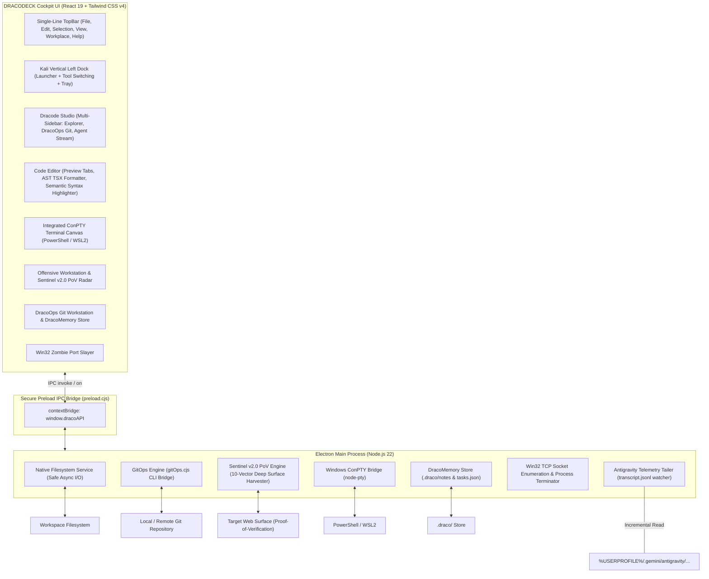

<div align="center">


# DRACODECK
### *The Offensive-Grade Developer Cockpit for Windows*

[](https://microsoft.com)
[](https://electronjs.org)
[](https://react.dev)
[](https://tailwindcss.com)
[](https://www.typescriptlang.org)
[](LICENSE)

</div>

---

## 1. Vision & Core Philosophy

**DRACODECK** is an offensive-grade developer cockpit for Windows built on Electron 45, React 19, Tailwind CSS v4, and Node.js 22.

The cockpit delivers native Kali Linux dark aesthetic ergonomics to Windows workstations with zero C++ compiler prerequisites:

* **Cyberdeck Ergonomics**: Strict Kali dark surfaces (`#0b0813`, `#120c1f`, `#161026`), 1px structural borders (`#261d38`), high-contrast cyan accents (`#00e5ff`), neon hot magenta indicators (`#ff007f`), and monospace typography.
* **Zero Compiler Bloat**: Standard npm installation without MSVC or external native compilation requirements.
* **Persistent Workspace Directory**: Select directory once on boot; persists across restarts with isolated subfolder scoping.
* **Unified Single-Line Header**: Compact `h-7` menu bar (`File`, `Edit`, `Selection`, `View`, `Workplace`, `Help`) wired to functional runtime commands.

---

## 2. Core Architecture



---

## 3. Workstations & Subsystems

### Dracode Studio & Multi-Sidebar
* **Multi-Sidebar Dock**: Instant tab switching between `EXPLORER`, `DRACOOPS GIT`, and `AI AGENT`.
* **VS Code Preview Tab Mode**: Single-click opens file in preview mode (*italic* tab title). Opening another file replaces the untouched preview tab. Double-clicking or editing pins the tab permanently.
* **AST TSX/JSX Code Formatter**: Bracket and tag-aware formatting engine handling JSX element trees, multi-line props, self-closing tags, and interface definitions without mangling string literals.
* **Deep Semantic Syntax Highlighter**: Real-time tokenization for control keywords, declarations, types, functions, JSX tags, attributes, string templates, numbers, and JSX comments (`{/* ... */}`).
* **Integrated ConPTY Terminal**: Collapsible terminal drawer (`Ctrl+\``) with persistent scrollback across view switches.

### DracoOps Git Workstation
* **Online vs Local Status**: Real-time detection of upstream remote URL and synchronization status.
* **Branch Switcher & Creator**: Dropdown branch switcher with instant new branch creation and checkout.
* **Working Tree & Unified Diff Viewer**: Grouped staged, unstaged, and untracked files with status codes (`S`, `M`, `U`), one-click stage/unstage/discard, and inline unified diff preview.
* **One-Click Commit & Sync**: Commit, commit & push, push, pull, and fetch operations.

### Sentinel v2.0 PoV Pentest Engine
* **10-Vector Deep Attack Surface Harvester**: Real-world verification matrix covering:
  1. Reflected Context Injection (Mathematical Canary Token Verification)
  2. SQLi Error & Boolean Differential Invariant Probing
  3. Path Traversal & Sensitive File Exposure
  4. CORS Misconfiguration & Dynamic Origin Reflection
  5. SSRF Localhost & Cloud Metadata Probe
  6. Open Redirect Header & Location Header Validation
  7. Prototype Pollution & Parameter Overwrite
  8. GraphQL Introspection & Hidden Query Exposure
  9. Command Injection & Subshell Delimiter Validation
  10. HTTP Header Security Baseline Audit
* **Shadow API & Secret Miner**: Crawler parsing inline scripts for unlinked endpoints, internal routes, and exposed credentials.
* **Side-Channel Micro-Timing Radar**: Statistical latency analysis detecting authorization bypass and user enumeration discrepancies.
* **Concurrency Race Burst**: High-throughput bursts evaluating state race conditions and duplicate actions.

### Win32 Port & Process Slayer
* **Live Socket Enumeration**: Scans developer ports: `3000` (Node/Next), `5173` (Vite), `8080` (HTTP), `5432` (PostgreSQL), `8000` (Python), `9222` (Chrome DevTools).
* **Tree Process Termination**: One-click process tree termination via native Windows APIs to liberate locked ports.

### Antigravity Telemetry Stream
* **Live JSONL Watcher**: Non-blocking stream reader observing agent reasoning, cognitive flow, and tool calls (`run_command`, `write_file`, `edit_file`).
* **Token HUD**: Real-time tracking of input and output token consumption.

### DracoMemory & Kanban Workstation
* **Persistent Markdown Notes**: Project scratchpads stored in `.draco/notes/`.
* **Kanban Matrix**: Task planning (`BACKLOG`, `IN_PROGRESS`, `REVIEW`, `DONE`) with priority ratings and tag filters stored in `.draco/project/tasks.json`.
* **Git Privacy Guard**: Automatic `.git/info/exclude` registration ensuring `.draco/` remains local.

---

## 4. Getting Started

### Prerequisites
* **Operating System**: Windows 10 or Windows 11 (64-bit)
* **Node.js**: Version 20 LTS or 22+

### Installation & Launch
```bash
# Clone the repository
git clone https://github.com/elrazaq/dracodeck.git
cd dracodeck

# Install dependencies
npm install

# Launch developer desktop environment
npm run dev

# Compile production bundle
npm run build
```

---

## 5. Keyboard Shortcuts Matrix

| Action | Shortcut |
| :--- | :--- |
| Save Active File | `Ctrl + S` |
| Find in File | `Ctrl + F` |
| Find & Replace Matrix | `Ctrl + H` |
| Auto-Format Code (Prettier Engine) | `Shift + Alt + F` |
| Toggle ConPTY Terminal | `Ctrl + \`` |
| Open DracoOps Git & Memory Workstation | `Alt + G` |
| Single-Click File in Explorer / Git | Open in Preview Mode |
| Double-Click File or Tab Header | Pin Tab Permanently |
| Duplicate Line Down | `Shift + Alt + ↓` |
| Delete Active Line | `Ctrl + Shift + K` |
| Minimize Cockpit | `Alt + F9` |
| Toggle Fullscreen | `F11` |
| Terminate Cockpit Session | `Alt + F4` |

---

## 6. License

Distributed under the **MIT License**. Engineered for developers who operate on the edge.
