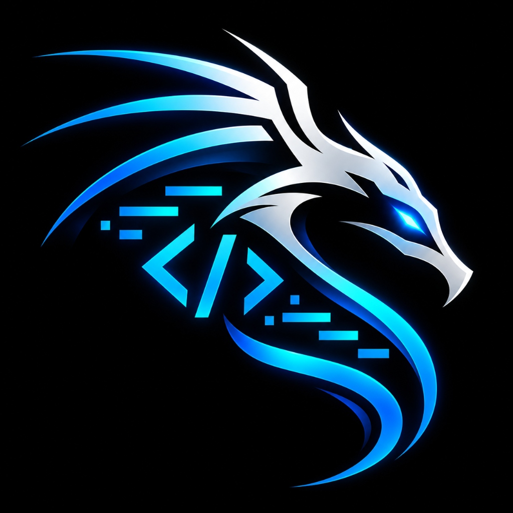
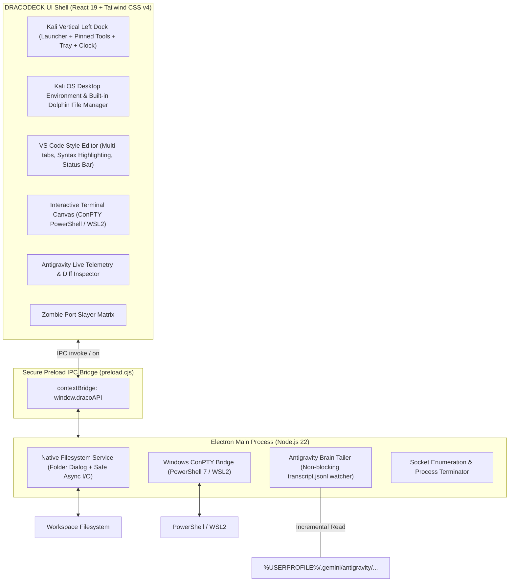

<div align="center">



# DRACODECK
### *The Offensive-Grade Developer Cockpit for Windows*

[](https://microsoft.com)
[](https://electronjs.org)
[](https://react.dev)
[](https://tailwindcss.com)
[](LICENSE)

</div>

---

## 1. Vision & Core Philosophy

**DRACODECK** bridges the gap between offensive cybersecurity aesthetics and modern software engineering.

In cybersecurity, **Kali Linux** is revered because it is self-contained, lethal, and equipped out-of-the-box with battle-tested tooling. **DRACODECK** transports that exact philosophy to Windows developer workstations:

* **Offensive-Grade Cyberdeck Ergonomics**: Strict Kali dark slate surfaces (`#0b0813`, `#120c1f`, `#161026`), precision 1px borders (`#261d38`), high-contrast cyan accents (`#00e5ff`), neon hot magenta status indicators (`#ff007f`), and crisp monospace typography (`JetBrains Mono`).
* **Zero Compiler Overhead**: Engineered on Electron 45 and Node.js 22, eliminating gigabytes of MSVC C++ build tools and platform prerequisites.
* **Persistent Workspace Onboarding**: On first boot, choose your workspace directory. It persists permanently with instant switching available directly from the Kali vertical dock.
* **Real-Time AI Telemetry**: Directly stream and observe Google Antigravity reasoning loops and tool invocations (`run_command`, `edit_file`) without file-locking lag.
* **Zombie Port Slayer**: One-click termination for hung background processes locking development ports (`3000`, `5173`, `8080`, `5432`).

---

## 2. Core Architecture



---

## 3. Features & Pillars

### ⚡ Persistent Workspace Initializer
- Clean, Kali-styled boot screen featuring the official Dracodeck Dragon insignia.
- Native folder dialog picker: select your workspace directory once, stored permanently in local storage.
- Easily change workspaces on the fly from the dock or settings drawer.

### 📁 Real-Time Dolphin File Explorer
- Live interactive filesystem directory tree with strict folder-first ascending sorting.
- Folder context menu with **Open Scope Here** to isolate sub-workspace focus.
- Dedicated file-type icons for TypeScript, React, JavaScript, Python, Dart, Rust, HTML, CSS, JSON, and Markdown.

### 📝 VS Code-Inspired Kali Dark Editor
- Multi-tab management with active file highlighting and dirty state indicators.
- Live file reading and editing with `Ctrl+S` instant disk saving.
- Authentic line-number gutter and Cyberpunk Violet syntax styling.
- Signature Hot Magenta status bar (`#ff007f`) matching your personal developer setup.

### 🛰️ Antigravity AI Telemetry Window
- Observability module listening to `%USERPROFILE%\.gemini\antigravity\brain\...\transcript.jsonl`.
- Live cards displaying tool calls (`run_command`, `write_file`, `edit_file`) and execution metrics.
- Cognitive flow accordion for inspecting model reasoning and chain-of-thought traces.

### 🎯 Zombie Port & Process Slayer
- Monitors local TCP ports: `1420` (Tauri), `5173` (Vite), `3000` (Node/Next), `8080` (HTTP), `5432` (PostgreSQL), `8000` (Python).
- 1-click `KILL` action to immediately liberate locked ports from stubborn zombie processes.

---

## 4. Getting Started

### Prerequisites:
- **Operating System**: Windows 10 or Windows 11 (64-bit)
- **Node.js**: Version 20 LTS or 22+

### Installation & Launch:
```bash
# Clone the repository
git clone https://github.com/elrazaq/dracodeck.git
cd dracodeck

# Install dependencies (only takes ~15 seconds)
npm install

# Start the native Windows desktop app
npm run dev
```

---

## 5. License

Distributed under the **MIT License**. Built with pride for developers who operate on the edge.
