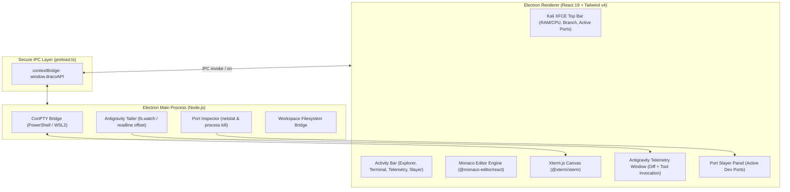

# Architecture: Project DRACODECK (Electron Edition)

## 1. System Overview

DRACODECK adalah desktop developer cockpit untuk Windows yang dibangun di atas **Electron (Node.js 22 + Chromium) + React 19 + Tailwind CSS v4**.



---

## 2. Component Specifications

### 2.1 Native ConPTY Terminal Bridge
- **Engine**: Node.js child_process / PTY streaming.
- **Protocol**: Menggunakan Electron IPC stream bidireksional (`ipcRenderer.send` / `ipcMain.on`) untuk menyalurkan input keystroke dan output terminal ke `@xterm/xterm`.

### 2.2 Antigravity Live Telemetry Tailer
- **Target File**: `%USERPROFILE%\.gemini\antigravity\brain\<conversation-id>\.system_generated\logs\transcript.jsonl`.
- **File Access**: Menggunakan Node.js `fs.createReadStream` dengan opsi tracking byte offset (`start: lastOffset`).
- **Parsing**: Line-by-line JSONL streaming parser memancarkan event pemanggilan tool (`run_command`, `edit_file`, dsb.) ke renderer process.

### 2.3 Zombie Port Slayer
- **Mekanisme**: Membaca port listening lokal via Windows `netstat -ano -p tcp` melalui Node.js subshell atau socket probe.
- **Aksi Kill**: `process.kill(pid)` atau Windows `taskkill /F /PID <pid>` untuk membersihkan port terkunci (`3000`, `5173`, `8080`, `5432`, `8000`).

---

## 3. Directory Map

```text
electron/
├── main.ts           # Window lifecycle, native menu, IPC listeners
└── preload.ts        # contextBridge API exposing safe dracoAPI

src/
├── components/
│   ├── layout/       # TopBar, ActivityBar, SplitPane, Shell
│   ├── editor/       # Monaco Editor wrapper & tabs
│   ├── terminal/     # Xterm.js container & PTY IPC hook
│   ├── telemetry/    # Antigravity live debug cards & diff viewer
│   ├── slayer/       # Port & process killer UI
│   └── explorer/     # Workspace file tree
├── types/            # IPC payloads & telemetry interfaces
├── index.css         # Tailwind v4 Kali Dark design tokens
└── App.tsx           # Shell root orchestrator
```
