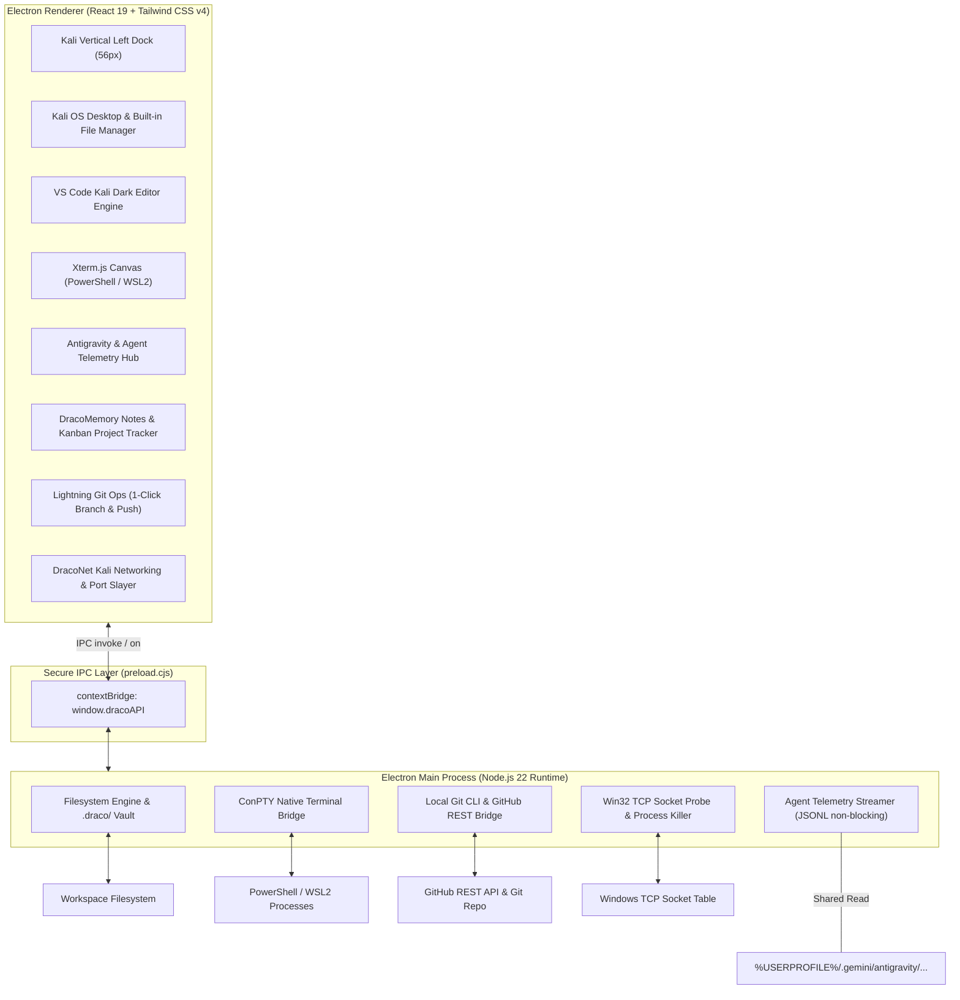

# Architecture: Project DRACODECK (Comprehensive Edition)

## 1. System Overview

DRACODECK adalah desktop developer cockpit untuk Windows yang menggabungkan filosofi *offensive-grade* Kali Linux dengan alur kerja rekayasa perangkat lunak modern, orkestrasi AI, dan manajemen proyek.



---

## 2. Component Specifications

### 2.1 DracoMemory & Project Management
- **Format Catatan**: Berkas Markdown (`.md`) disimpan di direktori `.draco/notes/`.
- **Manajemen Proyek**: Task list dan board Kanban bertipe JSON disimpan di `.draco/project/tasks.json`.
- **Jadwal & Tracking**: Indikator progres tanggal, deadline, dan badge prioritas (Critical, High, Medium, Low).

### 2.2 DracoGit Ops (1-Click Lightning Operations)
- **Branch Management**: Mengambil daftar branch aktif lokal & remote, switch branch via IPC command cepat (`git switch <branch>`).
- **One-Click Commit & Push**: Menggabungkan stage all, commit, dan push dalam satu aksi tombol di UI tanpa perlu menulis perintah git manual di terminal.

### 2.3 DracoAgent Multi-Bridge
- **Google Antigravity**: Tailing berkas `transcript.jsonl` non-blocking dengan Windows flag `FILE_SHARE_READ`.
- **GitHub Copilot & Codex**: Adapter untuk memantau status sesi, token penggunaan, dan alur sintesis kode.

### 2.4 DracoNet (Kali Linux Offensive Networking Suite)
- **Socket Probe**: Pemindai port listening lokal dan subnet berbasis soket murni Node.js.
- **HTTP / Header Inspector**: Debugger permintaan HTTP/API instan.
- **Zombie Port Slayer**: Scanner socket TCP Windows dengan terminasi proses 1-klik untuk port dev terkunci (`3000`, `5173`, `8080`, `5432`, `8000`).

---

## 3. Directory Map

```text
electron/
├── main.cjs          # Window lifecycle, native menu, IPC listeners
└── preload.cjs       # contextBridge API exposing safe dracoAPI

src/
├── components/
│   ├── layout/       # LeftDock, TopBar, SplitPane, Shell
│   ├── desktop/      # Kali OS Desktop & Built-in File Manager
│   ├── editor/       # VS Code Kali Dark Editor
│   ├── terminal/     # Xterm.js container & PTY IPC hook
│   ├── telemetry/    # Antigravity & Agent live debug cards
│   ├── memory/       # DracoMemory notes & Kanban project tracker
│   ├── git/          # 1-click Git Ops bar & branch switcher
│   └── slayer/       # DracoNet socket scanner & process killer
├── types/            # IPC payloads & telemetry interfaces
├── index.css         # Tailwind v4 Kali Dark design tokens
└── App.tsx           # Shell root orchestrator
```
