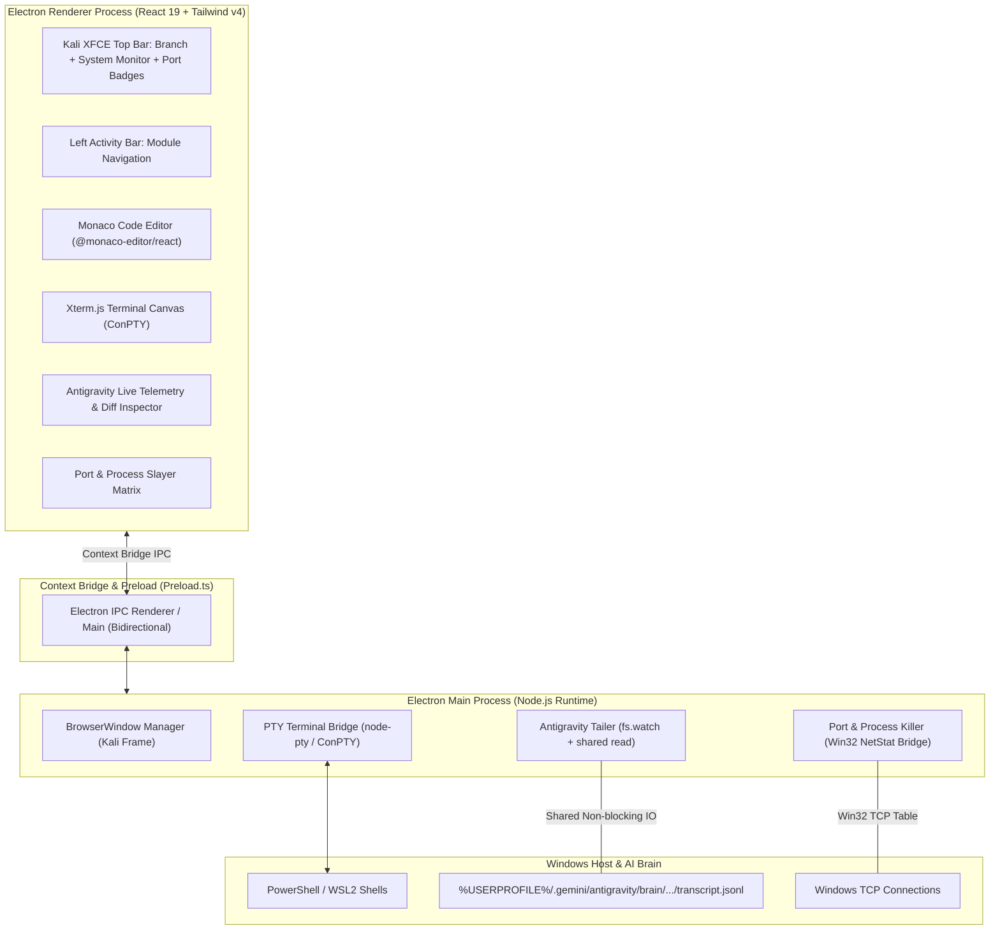

# M0: Milestone Master Plan — DRACODECK
### *The Offensive-Grade Developer Cockpit for Windows*

---

## 1. Master Objective & Non-Negotiable Directives

Dokumen ini adalah **Milestone 0 (M0)** master plan untuk proyek **DRACODECK** berbasis arsitektur **Electron (Node.js + React 19 + Tailwind v4)**.

### Aturan Pokok Pengembangan (Strict Rules):
1. **Mandatory Skills Enforcement**:
   - **`caveman`**: Terse, padat fakta teknis, to-the-point, no filler.
   - **`design-taste-frontend`**: Anti-slop frontend, Kali Dark/Cyberdeck art direction, monospace JetBrains Mono, high density data.
   - **`hallmark`**: Otentisitas visual, token-based palette, data nyata tanpa fake metrics.
   - **`ponytail`**: Solusi paling ringkas & minimalis, YAGNI ekstrem, tolak over-engineering.
   - **`ponytail-audit`**: Audit kualitas codebase menyeluruh.
   - **`ponytail-review`**: Tinjauan mendalam setiap baris kode & analisis risiko.

2. **Single Source of Truth (`AGENTS.md` & `GEMINI.md`)**:
   - Pedoman tertinggi di repo. Wajib dibaca dan dipatuhi di setiap sesi.

3. **Zero C++ Compiler Dependency (The Electron Decision)**:
   - Menghilangkan dependensi Visual Studio C++ Build Tools (6.7 GB) dan toolchain Rust.
   - Cukup menggunakan **Node.js runtime** murni untuk desktop window dan native OS services.

---

## 2. Core Architecture & Stack (Electron + React 19)



---

## 3. Milestones Roadmap (M0 - M4)

| Milestone | Target & Deliverables | Spec Document | Status |
| :--- | :--- | :--- | :--- |
| **M0: Master Plan & Foundation Docs** | Transisi arsitektur ke Electron, pembaruan seluruh docs, eliminasi C++ overhead. | [m0-master-plan.md](m0-master-plan.md) | **ACTIVE** |
| **M1: Kali Dark Shell & Electron Scaffold** | Scaffold Electron BrowserWindow, Kali tokens di Tailwind v4, TopBar, ActivityBar, SplitPane. | [m1-kali-shell.md](m1-kali-shell.md) | Ready |
| **M2: Terminal PTY & Monaco Integration** | PTY bridge PowerShell/WSL2 ke xterm.js via IPC, Monaco Editor dengan Kali Dark theme. | [m2-terminal-editor.md](m2-terminal-editor.md) | Planned |
| **M3: Antigravity Live Telemetry Engine** | Watcher `transcript.jsonl` non-blocking, parser streaming event, live diff & thinking viewer. | [m3-telemetry-engine.md](m3-telemetry-engine.md) | Planned |
| **M4: Zombie Port Slayer & Packaging** | Scanner port development lokal, 1-click process killer, packaging Windows `.exe` installer. | [m4-port-slayer.md](m4-port-slayer.md) | Planned |

---

## 4. File Structure Convention

```text
d:/dracodex/
├── .agents/skills/              # 6 Mandatory skills
├── docs/                        # Complete architecture & milestone specs
│   ├── m0-master-plan.md        # Master milestone blueprint (This file)
│   ├── m1-kali-shell.md         # M1: Kali Shell & Electron Window
│   ├── m2-terminal-editor.md    # M2: ConPTY Terminal & Monaco
│   ├── m3-telemetry-engine.md   # M3: Antigravity Live Telemetry
│   ├── m4-port-slayer.md        # M4: Zombie Port Slayer & Hardening
│   ├── architecture.md          # Technical architecture & IPC contracts
│   ├── decisions.md             # Architecture Decision Records (ADRs)
│   ├── roadmap.md               # Detailed multi-phase execution plan
│   ├── setup.md                 # Prerequisites (Node.js only)
│   └── skills.md                # Agent skill enforcement manual
├── electron/                    # Electron Main Process & Preload
│   ├── main.ts                  # Window lifecycle & IPC handlers
│   └── preload.ts               # Secure contextBridge API
├── src/                         # React 19 Frontend Shell
├── AGENTS.md                    # Primary Agent Directives
└── GEMINI.md                    # Antigravity / Gemini Instructions
```
