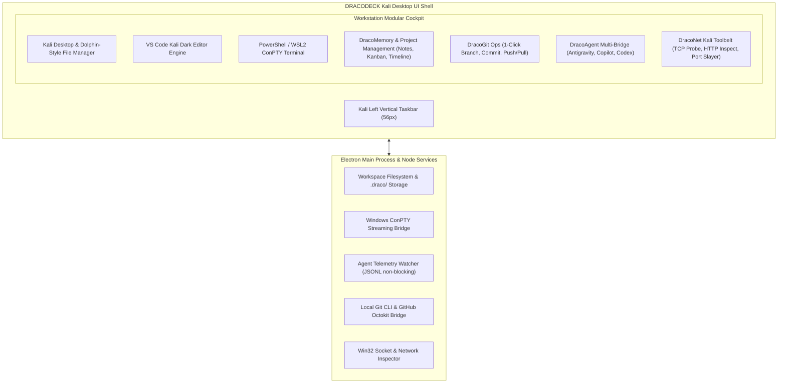

# M0: Milestone Master Plan — DRACODECK
### *The Offensive-Grade Developer Cockpit for Windows*

---

## 1. Master Objective & Non-Negotiable Directives

Dokumen ini adalah **Milestone 0 (M0)** master plan komprehensif untuk proyek **DRACODECK** berbasis arsitektur **Electron (Node.js 22 + Chromium + React 19 + Tailwind v4)**.

### Aturan Pokok Pengembangan:
1. **Mandatory Skills Enforcement**:
   - **`caveman`**: Terse, padat fakta teknis, to-the-point, no filler.
   - **`design-taste-frontend`**: Anti-slop frontend, Kali Dark/Cyberdeck art direction, monospace JetBrains Mono, high density data.
   - **`hallmark`**: Otentisitas visual, token-based palette, data nyata tanpa fake metrics.
   - **`ponytail`**: Solusi paling ringkas & minimalis, YAGNI ekstrem, tolak over-engineering.
   - **`ponytail-audit`**: Audit kualitas codebase menyeluruh.
   - **`ponytail-review`**: Tinjauan mendalam setiap baris kode & analisis risiko.

2. **Single Source of Truth (`AGENTS.md` & `GEMINI.md`)**:
   - Pedoman tertinggi di repo. Wajib dibaca dan dipatuhi di setiap sesi.

3. **Zero C++ Compiler Dependency**:
   - Bebas instalasi Visual Studio Build Tools (0 GB MSVC). Cukup Node.js runtime.

---

## 2. Empat Pilar Konsep Besar DRACODECK



### 2.1 DracoMemory & Project Management (Internal Notes & Tracking)
- **Local-First Knowledge Vault**: Catatan internal developer dan scratchpad sesi tersimpan di `.draco/notes/`.
- **Project Management (GitHub-Style)**: Kanban board lokal (Backlog, In Progress, Review, Done) dan milestone issue tracker.
- **Scheduling & Tracking**: Timeline visual dan checklist tugas berbatas waktu (*deadline & progress tracker*).

### 2.2 DracoGit Ops (1-Click Lightning Operations)
- **Instant Branch Switcher**: Dropdown cepat untuk pindah branch, buat branch baru, atau checkout dalam hitungan milidetik.
- **1-Click Commit & Sync**: Input pesan commit cepat, tombol 1-klik `[ STAGE & COMMIT ]` dan `[ SYNC PUSH/PULL ]`.
- **GitHub Mission Control**: Integrasi REST API GitHub untuk memantau PR, issues, dan status CI/CD Actions.

### 2.3 DracoAgent Multi-Bridge (AI Orchestration Hub)
- **Antigravity Live Telemetry**: Streaming tool invocation (`run_command`, `edit_file`), chain-of-thought, dan visualizer diff hijau/merah.
- **GitHub Copilot & Codex Adapter**: Unified AI HUD untuk memantau aktivitas model, konsumsi token, dan integrasi prompting.

### 2.4 DracoNet (Kali Linux Offensive Networking Suite)
- **Fast TCP Port Probe**: Pemindai port lokal dan remote berbasis socket Node.js (`Nmap`-lite).
- **HTTP / API Inspector**: Penguji endpoint REST/cURL cepat dengan inspeksi header mentah, latency, dan TLS certs.
- **Zombie Port Slayer**: Scanner socket Windows (`netstat`) dengan tombol 1-klik `KILL` proses pengunci port dev (`3000`, `5173`, `8080`, `5432`, `8000`).

---

## 3. Milestones Roadmap (M0 - M5)

| Milestone | Target & Deliverables | Spec Document | Status |
| :--- | :--- | :--- | :--- |
| **M0: Master Plan & Foundation Docs** | Transisi arsitektur ke Electron, blueprint 4 pilar besar, eliminasi C++ overhead. | [m0-master-plan.md](m0-master-plan.md) | **ACTIVE** |
| **M1: Kali Dark Shell & Electron Scaffold** | Scaffold Electron BrowserWindow, Kali tokens di Tailwind v4, TopBar, ActivityBar, SplitPane. | [m1-kali-shell.md](m1-kali-shell.md) | Done |
| **M1.1: Kali OS Experience & Native File Manager** | Koreksi logo Dracodeck, left vertical dock, Kali OS desktop, internal file manager (folders first). | [m1-1-kali-os-experience.md](m1-1-kali-os-experience.md) | Done |
| **M1.2: Desktop OS, Syntax & Workspace Scoping** | Syntax highlighting komplit, ikon file spesifik, fullscreen boot & shutdown, right-click Open Scope Here. | [m1-2-desktop-syntax-scoping.md](m1-2-desktop-syntax-scoping.md) | **NEXT** |
| **M2: Terminal ConPTY & Monaco Editor** | PTY bridge PowerShell/WSL2 ke xterm.js via IPC, Monaco Editor dengan Kali Dark theme. | [m2-terminal-editor.md](m2-terminal-editor.md) | Planned |
| **M3: Antigravity & Agent Telemetry Hub** | Watcher `transcript.jsonl` non-blocking, parser streaming event, live diff & thinking viewer. | [m3-telemetry-engine.md](m3-telemetry-engine.md) | Planned |
| **M4: DracoNet & Zombie Port Slayer** | Win32 socket scanner, 1-klik kill zombie port dev, HTTP/TCP endpoint probe, Windows packaging. | [m4-port-slayer.md](m4-port-slayer.md) | Planned |
| **M5: DracoMemory & 1-Click Git Ops** | Catatan internal, Kanban project tracker, scheduling, 1-click branch/commit/push GitHub. | [m5-memory-gitops.md](m5-memory-gitops.md) | Planned |

---

## 4. Konvensi Penyimpanan Proyek (`.draco/`)

Untuk menjaga persistensi mandiri tanpa mengotori berkas kode pengguna:
```text
<WORKSPACE_ROOT>/
├── .draco/
│   ├── config.json       # Workspace settings & preference
│   ├── notes/            # Internal markdown notes & scratchpads
│   └── project/          # Kanban tasks, milestones & schedules
├── ...                   # Source code pengguna
```
