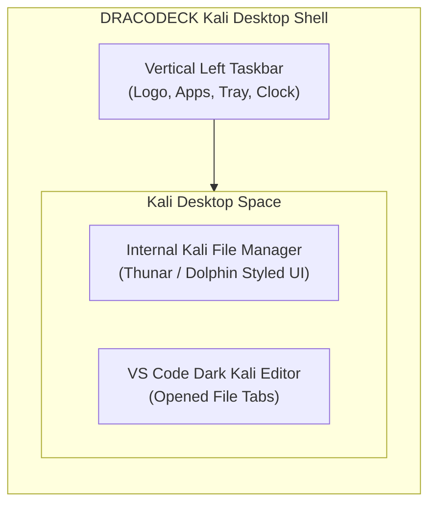

# Milestone 1.1: Kali Linux OS Desktop Experience & Native File Manager

Dokumen spesifikasi revisi mendalam untuk **Milestone 1.1 (M1-1)** proyek **DRACODECK**.

---

## 1. Identitas & Koreksi Typo Logo

Berdasarkan referensi visual terbaru pengguna:
- **Nama Resmi**: **DRACODECK** (koreksi dari kesalahan nama *Dracodex*).
- **Aset Logo Baru**: Berkas logo `Dracodeck` dengan tipografi naga cyber dan aksen huruf `k` elektrik biru (`media_1793438146871_83e80c9d.jpg`).
- **Lokasi Target Aset**: `public/dracodeck-logo.jpg` dan `src/assets/dracodeck-logo.jpg`.

---

## 2. Ekstraksi Skema Warna Otentik dari Setup VS Code Pengguna

Berdasarkan screenshot setup VS Code pengguna (`media_1793439016508_1f163e8d.jpg`), skema warna diselaraskan secara presisi ke estetika **Cyberpunk Violet / Kali Cyberdeck**:

| Elemen UI | Hex Code | Deskripsi & Titik Penggunaan |
| :--- | :--- | :--- |
| **Status Bar Utama (Signature)** | `#ff007f` / `#e0007b` | Neon Hot Magenta penuh di bar status bawah layar (kontras teks gelap). |
| **Activity Bar & Badge** | `#120c1f` & `#ff007f` | Background Activity Bar ungu pekat dengan badge notifikasi pink magenta menyala. |
| **Sidebar / Explorer** | `#161026` | Permukaan panel file explorer dan drawer kiri (deep eggplant slate). |
| **Border Divider** | `#261d38` | Garis pembatas panel 1px violet gunmetal halus. |
| **Editor Canvas Void** | `#0b0813` | Background utama area penulisan kode editor (deep obsidian violet). |
| **Active Item / Tab Highlight**| `#281b3d` | Background berkas terpilih di explorer dan tab editor yang sedang aktif. |
| **Syntax Keyword** | `#00e676` / `#05df72` | Mint Green untuk keyword sintaks (`export`, `function`, `return`, `if`). |
| **Syntax String / Variables** | `#00e5ff` / `#38bdf8` | Kali Cyan untuk prompt terminal `PS`, string, dan variabel. |
| **Git Modified / Tags** | `#ff8800` | Amber orange untuk badge modified `M` dan tag markdown. |
| **Text Primary / Muted** | `#e2e8f0` / `#7a7194` | Teks utama putih keperakan, komentar kode ungu keabuan. |

---

## 3. Arsitektur Layout: Kali Linux Left Vertical Taskbar

Berdasarkan screenshot referensi desktop Kali Linux XFCE/KDE:
- **Posisi Taskbar**: Di **sebelah kiri layar (Left Vertical Dock)** secara penuh dari atas ke bawah (`h-screen w-14` / ~56px).
- **Struktur Elemen Vertical Taskbar**:
  1. **Top Section**:
     - Tombol Launcher Utama: Logo Naga Kali Dracodeck (membuka Kali Application Whisker Menu).
     - Separator tipis gunmetal (`#1b253b`).
  2. **Middle Section (Pinned Launchers & Running Tasks)**:
     - `File Manager`: Membuka jendela / tampilan internal Kali File Explorer.
     - `ConPTY Terminal`: Membuka terminal interaktif PowerShell/WSL2 bergaya Kali dark.
     - `Antigravity Telemetry`: Observabilitas proses live agent AI.
     - `Port Slayer`: Pembasmi zombie port dev.
     - `Workspace Switcher`: Tombol 1-klik untuk mengganti direktori kerja.
  3. **Bottom Section (System Tray & Clock)**:
     - Indikator koneksi / status port.
     - Jam vertikal atau stacked digital clock (misal: `03:37` / `AM`).
     - Indikator status workspace aktif.

---

## 3. UI Tampilan Awal: Kali Linux Desktop & Built-in File Manager

Tampilan awal aplikasi tidak menggunakan kartu generic, melainkan menghadirkan **lingkungan desktop Kali Linux mandiri**:



### 3.1 Spesifikasi Internal Kali File Manager (Thunar/Dolphin Style):
File explorer dibangun di dalam aplikasi itu sendiri (bukan mengandalkan file picker native Windows):
1. **Header & Navigation Bar**:
   - Tombol navigasi: Back (`<`), Forward (`>`), Up Directory (`^`), Refresh.
   - Breadcrumb path interaktif: `Home > Workspace > src > components`.
2. **Left Places Sidebar**:
   - Section *Places*: `Workspace Root`, `Documents`, `Recent`, `Trash`.
   - Section *Shortcuts*: Quick access ke folder-folder utama dalam workspace (`docs`, `src`, `electron`).
3. **Main Content Pane (Folder & File Matrix)**:
   - Tampilan grid / list dengan icon neon folder (Cyan `#00e5ff` / Blue `#2979ff`).
   - Double click / klik folder: masuk ke dalam folder.
   - Klik berkas file: membuka file ke dalam editor VS Code Kali Dark.
4. **Bottom Status Bar**:
   - Menampilkan ringkasan riil: `X Folders, Y Files (Z KB) | Free Space`.

---

## 4. Algoritma Sorting File Explorer (Folder-First Ascending)

Sesuai aturan ketat pengguna, isi direktori workspace **HARUS** diurutkan ascending dengan folder di urutan teratas, tanpa ada file yang berselang-seling:

```ts
export function sortWorkspaceEntries(entries: Array<{ name: string; isDirectory: boolean; path: string }>) {
  return entries.sort((a, b) => {
    // 1. Folders selalu ditempatkan sebelum file
    if (a.isDirectory && !b.isDirectory) return -1;
    if (!a.isDirectory && b.isDirectory) return 1;

    // 2. Di dalam kelompok yang sama (folder vs folder, file vs file), urutkan ascending A-Z
    return a.name.localeCompare(b.name, undefined, {
      numeric: true,
      sensitivity: 'base',
    });
  });
}
```

### Contoh Hasil Urutan:
```text
[DIR]  .agents/
[DIR]  docs/
[DIR]  electron/
[DIR]  public/
[DIR]  src/
[FILE] .gitignore
[FILE] AGENTS.md
[FILE] GEMINI.md
[FILE] README.md
[FILE] index.html
[FILE] package.json
[FILE] tsconfig.json
[FILE] vite.config.ts
```
*(Seluruh direktori berkumpul di atas, diikuti seluruh berkas file).*

---

## 5. Tampilan Editor VS Code Bergaya Kali Linux

Ketika berkas di File Manager diklik:
- Terbuka panel editor VS Code bernuansa Kali Dark (`#0a0e17`).
- Multi-tabs di bagian atas dengan status file aktif dan tombol tutup tab.
- Line numbers gutter di sisi kiri.
- Status bar bawah khas VS Code (Ln/Col, UTF-8, LF, Jenis Bahasa pemrograman).
- Pintasan keyboard `Ctrl+S` untuk menyimpan langsung ke disk.

---

## 6. Verification & Acceptance Criteria (M1-1)

1. **Logo Verification**:
   - Memastikan logo menampilkan tulisan **Dracodeck** (bukan Dracodex).
2. **Layout Dock Verification**:
   - Taskbar berada vertikal di sebelah kiri (`left: 0`, full height), bukan di atas.
3. **Sorting Verification**:
   - Seluruh folder tampil di bagian atas secara alfabetis (A-Z).
   - Seluruh file tampil di bawah folder secara alfabetis (A-Z).
   - Tidak ada file yang bercampur di sela-sela folder.
4. **File Manager Integrity**:
   - File explorer tampil sebagai antarmuka bergaya Dolphin/Thunar Kali Linux di dalam window aplikasi.
   - Navigasi folder dan pembukaan file berfungsi mulus.

