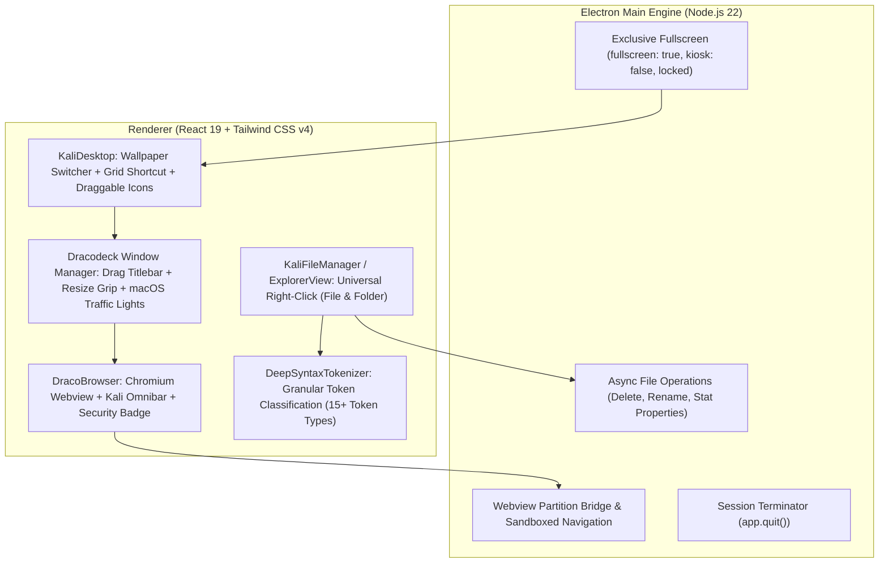

# Milestone 1.3: Advanced Kali Desktop, macOS Windowing, DracoBrowser & Deep Syntax

Dokumen spesifikasi teknis untuk **Milestone 1.3 (M1-3)** proyek **DRACODECK**.

---

## 1. Ringkasan Eksekutif & Permintaan Pengguna

Berdasarkan arahan revisi:
1. **Desktop Background Switcher & App Shortcuts**:
   - Pengguna dapat mengganti background desktop dari pilihan wallpaper bawaan (Kali Cosmic Void, Cyber Dragon, Obsidian Matrix, Deep Abyss) maupun upload wallpaper kustom.
   - Ikon shortcut aplikasi di desktop bergaya Windows (Dracodeck Editor, Kali Terminal, DracoBrowser, Port Slayer, Antigravity Telemetry, File Manager, Trash).
2. **Built-in Chromium Browser (DracoBrowser)**:
   - Browser web internal berbasis Chromium dengan chrome UI khas Kali Linux Dark.
   - Dilengkapi Omnibar URL, navigasi (Back, Forward, Refresh, Home), Bookmark shelf (Kali Tools, Exploit-DB, GitHub, Antigravity Docs), dan DevTools toggle.
3. **Deep Semantic Syntax Highlighting**:
   - Peningkatan sistem pewarnaan teks sintaks agar jauh lebih detail dan bertingkat (AST/grammar tokenisasi lebih dalam: membedakan control keywords vs declaration keywords, types vs interfaces, function definition vs call, property access, numbers, booleans, operators, decorators, dan template literal expressions).
4. **Universal File & Folder Context Menu**:
   - Menu klik kanan kini aktif baik pada **folder** (`Open Scope Here`, `Copy Path`, `Cut`, `Paste`, `Rename`, `Delete`, `Properties`) maupun **file** (`Open in Editor`, `Open External`, `Copy Path`, `Copy Relative Path`, `Rename`, `Delete`, `File Properties`).
5. **macOS-Style Window Management & Drag-and-Drop**:
   - Floating window pada desktop mengadopsi kontrol traffic lights macOS di pojok kiri atas: Merah (`#ff5f56` - Close), Kuning (`#ffbd2e` - Minimize), Hijau (`#27c93f` - Maximize/Restore).
   - Window dapat di-drag posisinya secara bebas pada desktop canvas.
   - Window dapat di-resize ukurannya melalui resize grip pojok kanan-bawah.
   - Ikon desktop dapat di-drag dan diatur posisinya.
6. **Exclusive Auto-F11 Fullscreen Enforced**:
   - Aplikasi saat dibuka langsung masuk mode F11 True Fullscreen secara otomatis.
   - Tidak dapat di-windowed secara tidak sengaja melalui window chrome.
   - Keluar hanya dapat dilakukan melalui tombol **Shutdown Cockpit** pada Left Dock atau navigasi OS Windows (`Alt+Tab` / `Win Key`).

---

## 2. Arsitektur Komponen Baru



---

## 3. Spesifikasi Mendalam: Deep Syntax Highlighting (Cyberpunk Violet)

Sistem pewarnaan sintaks ditingkatkan dari pemetaan flat menjadi klasifikasi token semantik berlapis:

| Kategori Token | Hex Color | Karakter Visual | Contoh Token |
| :--- | :--- | :--- | :--- |
| **Control Keywords** | `#00e676` | Mint Green Bold | `if`, `else`, `return`, `switch`, `case`, `break`, `try`, `catch`, `throw`, `while`, `for`, `await`, `yield` |
| **Declaration Keywords**| `#00e5ff` | Electric Cyan | `const`, `let`, `var`, `function`, `class`, `interface`, `type`, `enum`, `import`, `export`, `from`, `extends`, `def`, `fn` |
| **Types & Interfaces** | `#38bdf8` | Sky Blue | `string`, `number`, `boolean`, `any`, `void`, `Promise<T>`, `Array`, `Map`, `Record`, PascalCase Custom Types |
| **Function Definitions**| `#ff007f` | Hot Magenta Bold | Nama fungsi pada saat deklarasi: `function processQueue()`, `def execute_payload()` |
| **Function Invocations**| `#f43f5e` | Neon Rose Pink | Panggilan fungsi: `console.log()`, `useState()`, `fetch()`, `Math.floor()` |
| **Object Properties**   | `#c084fc` | Light Violet | Akses properti objek: `user.profile.name`, `event.currentTarget`, `res.status` |
| **String Literals**     | `#ffb74d` | Soft Amber Peach | `"hello"`, `'path/to/file'`, multi-line strings |
| **Template Literals**   | `#ffcc80` | Light Peach with Cyan Var | `` `count: ${total}` `` (variabel di dalam `${}` di-highlight terpisah) |
| **Numbers & Hex**       | `#ff9100` | Tangerine Orange | `42`, `3.14159`, `0xFF00AA`, `-1`, `1000n` |
| **Booleans & Nullables**| `#ffd600` | Cyber Yellow Bold | `true`, `false`, `null`, `undefined`, `None`, `nil` |
| **Operators**           | `#a3e635` | Lime Green | `+`, `-`, `*`, `/`, `=`, `===`, `!==`, `&&`, `||`, `=>`, `?`, `:`, `...` |
| **Punctuation**         | `#94a3b8` | Slate Steel | `{`, `}`, `(`, `)`, `[`, `]`, `;`, `,`, `.` |
| **Decorators / Macros** | `#e879f9` | Magenta Violet | `@Component`, `@override`, `#[derive]`, `@app.route` |
| **HTML/JSX Tags**       | `#ff1744` | Coral Red | `<div`, `</span`, `<App`, `<Component` |
| **HTML/JSX Attributes** | `#22d3ee` | Bright Cyan | `className=`, `onClick=`, `href=`, `style=` |
| **Comments**            | `#64748b` | Steel Muted Italic | `// line comment`, `/* multi-line */`, `# python comment`, `-- sql` |

---

## 4. Built-in Chromium DracoBrowser

### 4.1 Desain Chrome Browser (Kali Dark Aesthetic):
- **Tab Strip**: Tab berbentuk trapezoid/rounded-top khas Kali Dark (`#120c1f`), dengan indikator tab aktif Hot Magenta (`#ff007f`) dan tombol Close (`x`). Tombol tab baru (`+`).
- **Omnibar (Address Input)**:
  - Tombol Navigasi: Back (`←`), Forward (`→`), Reload/Stop (`⟳`), Home (`⌂`).
  - Input URL: Background `#0b0813`, border `#261d38`, font monospace, dengan ikon SSL padlock hijau (`🔒`).
  - Badge Status Keamanan: `OFFENSIVE PROXY: DIRECT` / `TOR GATEWAY: IDLE`.
  - Tombol DevTools (`{ }`) untuk inspect element.
- **Bookmark Quick Shelf**:
  - `Kali Docs` -> `https://www.kali.org/docs/`
  - `Exploit-DB` -> `https://www.exploit-db.com/`
  - `GitHub` -> `https://github.com/`
  - `Antigravity` -> `https://deepmind.google/`
  - `StackOverflow` -> `https://stackoverflow.com/`
- **Render Area**: `<webview>` tag Electron terisolasi (`partition="persist:dracobrowser"`), memuat konten web Chromium native dengan akselerasi hardware.

---

## 5. macOS-Style Window Management & Desktop Interaction

### 5.1 macOS Window Controls (Traffic Lights):
Setiap floating window di desktop memiliki 3 tombol lingkaran di pojok kiri atas header:
- **Merah (`#ff5f56`)**: Menutup window (`closeWindow()`). Hover menampilkan ikon silang (`×`).
- **Kuning (`#ffbd2e`)**: Minimize window ke dock/taskbar (`minimizeWindow()`). Hover menampilkan minus (`-`).
- **Hijau (`#27c93f`)**: Maximize atau restore window ke ukuran default (`toggleMaximize()`). Hover menampilkan expand (`⤢`).

### 5.2 Drag & Drop Desktop Space:
- **Window Dragging**: Mengklik dan menahan title bar window memungkinkan pemindahan bebas di seluruh viewport desktop dengan bounding limit agar tidak keluar layar.
- **Window Resizing**: Handle segitiga di pojok kanan-bawah window dengan cursor `nwse-resize` untuk mengubah dimensi `width` dan `height` secara interaktif.
- **Desktop Shortcut Icons**: Ikon desktop (VS Code Editor, Kali Terminal, DracoBrowser, File Manager, Port Slayer, Telemetry, Trash) dapat diatur dan diposisikan ulang dengan drag-and-drop.

### 5.3 Wallpaper Switcher:
Menu klik kanan pada wallpaper desktop menghadirkan pilihan:
- **Change Desktop Wallpaper**:
  1. *Kali Cosmic Void* (Default radial nebula `#1d1430` / `#07050a`)
  2. *Cyber Dragon Dark* (Branding logo naga digital Dracodeck)
  3. *Obsidian Matrix Grid* (Cyberpunk geometric grid)
  4. *Deep Ocean Abyss* (Dark teal Kali ocean)
  5. *Custom Image Upload* (URL / local image file path)
- Pilihan wallpaper disimpan permanen pada `localStorage.getItem('dracodeck_wallpaper')`.

---

## 6. Universal Right-Click Context Menu (File & Folder)

Komponen `ContextMenu.tsx` diperluas untuk mendeteksi target bertipe `folder` atau `file`:

### 6.1 Menu Folder:
- `🎯 Open Scope Here` (Isolasi workspace ke subfolder ini)
- `📋 Copy Path`
- `✂️ Cut`
- `📄 Paste`
- `✏️ Rename`
- `🗑️ Delete`
- `ℹ️ Properties`

### 6.2 Menu File:
- `⚡ Open in Draco Editor` (Buka file ke editor multi-tab Dracodeck)
- `🌐 Open in DracoBrowser` (Khusus file `.html`, `.svg`, `.json`, `.md`)
- `📋 Copy Absolute Path`
- `📎 Copy Relative Path`
- `✏️ Rename`
- `🗑️ Delete File` (Dialog konfirmasi penghapusan aman)
- `ℹ️ File Properties` (Nama, Ukuran berkas, Tanggal modifikasi, Ekstensi/MIME)

---

## 7. Exclusive Auto-F11 Fullscreen Enforced

### 7.1 Lifecycle & Guards di Electron (`electron/main.cjs`):
```javascript
mainWindow = new BrowserWindow({
  fullscreen: true,          // Masuk mode F11 eksklusif seketika saat boot
  fullscreenable: true,
  autoHideMenuBar: true,     // Hilangkan menu bar Windows bawaan
  frame: false,              // Frameless window (tanpa baris minimize/maximize Windows)
  backgroundColor: '#0b0813',
  webPreferences: {
    webviewTag: true,        // Mengaktifkan DracoBrowser Chromium webview
    preload: path.join(__dirname, 'preload.cjs'),
  }
});
```
- **Kiosk / Locked Ergonomics**: Menghilangkan tombol window restore bawaan OS. Pengguna hanya dapat beralih aplikasi menggunakan hotkey OS Windows standard (`Alt+Tab`, `Win Key`) atau mematikan workstation menggunakan tombol **Shutdown** resmi di dock kiri.

---

## 8. Kriteria Penerimaan & Verifikasi (DoD)

1. **Auto F11**: Aplikasi boot langsung fullscreen penuh tanpa border window Windows.
2. **macOS Traffic Lights**: Window Thunar / Terminal / Browser memiliki tombol merah, kuning, hijau di kiri atas yang responsif.
3. **Window Drag & Resize**: Window dapat digeser posisinya dan diubah ukurannya dengan smooth.
4. **DracoBrowser**: Browser Chromium internal dapat membuka URL web (`google.com`, `github.com`, dsb.) dengan kontrol navigasi lengkap.
5. **Universal Context Menu**: Klik kanan pada file menampilkan opsi file (Open in Editor, Copy Path, Delete, Properties), klik kanan pada folder menampilkan `Open Scope Here`.
6. **Wallpaper Switcher**: Wallpaper desktop dapat diganti dari menu klik kanan desktop dan tersimpan permanen.
7. **Deep Syntax**: Kode sumber di editor menampilkan pewarnaan bertingkat tajam (variabel, keyword, fungsi, tipe, angka, operator, string).
