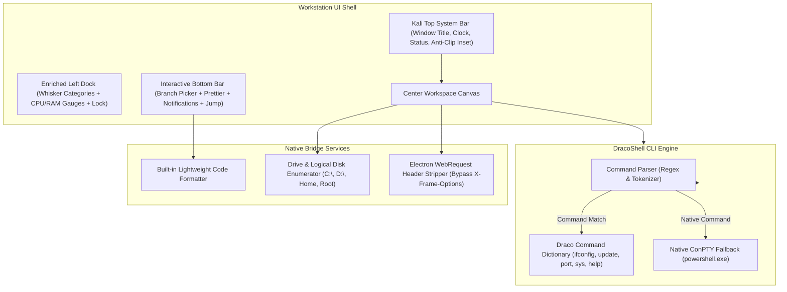

# Milestone 2.1: Core Hardening, DracoShell CLI & Universal Workstation (M2-1)

Dokumen spesifikasi teknis untuk implementasi perbaikan kritis dan peningkatan fitur pada **Milestone 2.1 (M2-1)** proyek **DRACODECK**.

---

## 1. Ringkasan Eksekutif & Permintaan Pengguna

Berdasarkan temuan pengujian dan arahan revisi:
1. **Layar Terpotong di Atas**:
   - Terjadi pemotongan batas atas window (offset clipping) akibat kombinasi frameless window (`frame: false`) dan fullscreen tanpa top inset/system header yang presisi. Perlu ditambahkan Kali Top System Bar yang presisi dan perbaikan geometry styling pada root canvas.
2. **DracoShell CLI Engine (Kamus Format Terminal Mandiri)**:
   - Terminal tidak hanya menjadi passthrough mentah, melainkan memiliki engine interpreter mandiri (**DracoShell**) dengan format output bertema Kali Linux:
     - `draco ifconfig` / `draco net`: Ringkasan interface jaringan (IP, MAC, Netmask, Gateway).
     - `draco update`: Pengecekan versi dan pembaruan aplikasi langsung dari terminal.
     - `draco port scan` & `draco port kill <port>`: Manajemen socket port cepat.
     - `draco sys`: Status sistem, CPU, RAM, OS, dan uptime.
     - Fallback otomatis ke perintah bawaan Windows PowerShell / WSL2 untuk perintah reguler.
3. **Akses Universal Semua Direktori PC/Laptop**:
   - File Manager dan Explorer View tidak lagi terkunci hanya pada workspace root, melainkan dapat membaca seluruh partisi drive lokal (`C:\`, `D:\`, dsb.) dan direktori user (`Desktop`, `Downloads`, `Documents`, Home `~`) dengan direct path input bar.
4. **Perbaikan Total DracoBrowser**:
   - Mengatasi pemblokiran halaman web akibat header keamanan `X-Frame-Options` dan `Content-Security-Policy` melalui interceptor sesi Electron (`session.webRequest.onHeadersReceived`), sehingga browser dapat membuka situs publik seperti Google, GitHub, Kali Docs secara mulus.
5. **Peningkatan Fitur Taskbar Kiri (Left Dock)**:
   - Memperkaya fitur Left Dock: Whisker Menu berkategori spesifik tool offensive Kali (Information Gathering, Vulnerability Analysis, Web Exploitation, Reverse Engineering), widget live hardware monitor (CPU & RAM usage), dan quick lock.
6. **Taskbar Bawah Interaktif (Interactive Status Bar)**:
   - Mengubah bottom bar statis menjadi suite widget interaktif:
     - Git Branch Switcher (klik untuk memilih/mengganti branch).
     - Tombol Prettier Auto-Format (format kode aktif dalam 1 klik).
     - Jump to Line/Column modal.
     - Notification & System Log drawer.
     - Encoding & Line-Ending selector (`UTF-8`, `LF`/`CRLF`).
7. **Penyempurnaan Syntax Tokenizer & Method Detection**:
   - Memperbaiki tokenizer agar mendeteksi method chaining (`.map()`, `.filter()`, `.then()`, `.catch()`, `.json()`, `.split()`), nested expressions, regex literals (`/.../g`), dan multiline comments (`/* ... */`).

---

## 2. Arsitektur Komponen Milestone 2.1



---

## 3. Spesifikasi Kamus Perintah DracoShell (`draco-cli`)

Setiap perintah internal menghasilkan output terformat rapi dengan ASCII header, status badge warna Kali (Mint Green `#00e676`, Hot Magenta `#ff007f`, Electric Cyan `#00e5ff`, Amber `#ff8800`):

| Perintah DracoShell | Alias | Deskripsi & Hasil Eksekusi |
| :--- | :--- | :--- |
| `draco help` | `draco --help`, `draco -h` | Menampilkan buku panduan kamus perintah DracoShell dan ASCII banner Dracodeck. |
| `draco ifconfig` | `draco net ifconfig`, `draco ip` | Memindai adapter jaringan fisik/virtual dan mencetak tabel antarmuka: IP lokal, IPv6, Netmask, MAC Address, dan status koneksi. |
| `draco update` | `draco sys update`, `draco upgrade` | Memeriksa versi rilis terbaru di repo GitHub ([elrazaq/dracodeck](https://github.com/elrazaq/dracodeck)), memvalidasi commit hash, dan menampilkan status update. |
| `draco port scan` | `draco ports`, `draco netstat` | Menampilkan seluruh port TCP listening lokal aktif beserta PID dan nama proses terkait. |
| `draco port kill <port>` | `draco kill <port>` | Menghentikan secara paksa (SIGKILL) proses zombie yang mengunci nomor port target. |
| `draco sys info` | `draco sys`, `draco uname` | Menampilkan spesifikasi hardware, versi Node.js/Electron, platform Win32, serta utilisasi CPU & Memory saat ini. |
| `draco format` | `draco prettier` | Memicu auto-format pada file yang sedang aktif dibuka di editor. |
| `draco clear` | `clear`, `cls` | Membersihkan buffer layar terminal. |
| `<perintah apa saja>` | `dir`, `cd`, `git`, `node`, dll. | Dialirkan langsung ke native PowerShell ConPTY runtime tanpa batasan. |

---

## 4. Akses Universal Drive PC/Laptop

### 4.1 Drive Scanner IPC API (`electron/main.cjs`):
- Pindai partisi Windows yang tersedia (`C:\`, `D:\`, `E:\`) menggunakan native probe `fs.access` atau `wmic logicaldisk`.
- Deteksi folder user standar via `os.homedir()`:
  - `Desktop` (`%USERPROFILE%\Desktop`)
  - `Downloads` (`%USERPROFILE%\Downloads`)
  - `Documents` (`%USERPROFILE%\Documents`)
  - `User Root` (`%USERPROFILE%`)
- Direct Path Bar: Kolom input breadcrumb di bagian atas File Manager memungkinkan pengguna mengetik langsung path apa pun (misal `C:\Windows\System32` atau `D:\Games`) dan langsung menjelajahinya.

---

## 5. Solusi Arsitektur DracoBrowser (Chromium Webview Interceptor)

### 5.1 Bypass Pembatasan Iframe / Webview:
Pada `electron/main.cjs`, pasang filter webRequest sebelum header diterima oleh renderer:

```javascript
session.defaultSession.webRequest.onHeadersReceived((details, callback) => {
  const responseHeaders = { ...details.responseHeaders };
  delete responseHeaders['x-frame-options'];
  delete responseHeaders['X-Frame-Options'];
  delete responseHeaders['content-security-policy'];
  delete responseHeaders['Content-Security-Policy'];

  callback({
    cancel: false,
    responseHeaders,
  });
});
```
Dengan mekanisme ini, situs besar (Google, GitHub, Wikipedia, Kali Docs) dapat dirender tanpa diblokir oleh kebijakan frame security.

---

## 6. Layout Geometry & Anti-Clipping Fix

### 6.1 Kali Top System Bar (`h-7` / 28px):
- Menambahkan bar atas permanen dengan background `#0e0a19`, border bawah `#261d38`:
  - Kiri: Watermark naga kecil, label status `DRACODECK COCKPIT // KALI RUNTIME`.
  - Tengah: Breadcrumb workspace aktif.
  - Kanan: Indikator status jaringan, jam UTC, dan kontrol window.
- Memastikan konten `main` di bawahnya memiliki offset bersih sehingga tidak ada elemen visual yang terpotong di tepi atas layar monitor pengguna.

---

## 7. Taskbar Kiri & Bawah Feature Enrichment

### 7.1 Left Dock Enrichment:
- **Offensive Categories Drawer**: Submenu popover yang mengelompokkan tool ke dalam standar Kali Linux:
  - `01 - Information Gathering`
  - `02 - Vulnerability Analysis`
  - `03 - Web Applications`
  - `04 - Reverse Engineering`
  - `05 - Dracodeck Cockpit Suite`
- **Hardware Telemetry Gauges**: Indikator mini bar CPU load dan RAM usage real-time.
- **Lock Screen Button**: Kunci sesi cockpit sementara.

### 7.2 Interactive Bottom Bar:
- **Branch Picker**: Klik nama branch (misal `main`) memunculkan popover daftar branch lokal/remote.
- **Prettier Action**: Tombol `Prettier` (dengan ikon checklist) memformat kode aktif seketika.
- **Go To Line / Col Modal**: Klik `Ln X, Col Y` membuka prompt untuk lompat ke baris tertentu.
- **Encoding & Line Endings**: Klik `UTF-8` atau `LF` untuk beralih mode.
- **Notification Drawer**: Klik ikon lonceng untuk melihat riwayat log IPC dan status terminal.

---

## 8. Peningkatan Syntax Highlighting & Code Formatter

### 8.1 Method Chaining & Deep Function Detection:
- Regex grammar baru untuk mengenali method invocation beruntun:
  - `.map(`, `.filter(`, `.reduce(`, `.forEach(`, `.find(`
  - `.then(`, `.catch(`, `.finally(`
  - `.json(`, `.text(`, `.send(`, `.status(`
  - `.split(`, `.join(`, `.replace(`, `.trim(`
- Regex literal detection: `/^[a-zA-Z0-9]+$/i` di-highlight warna Peach `#ffb74d`.
- Multiline block comment `/* ... */` dideteksi melintasi banyak baris.
- Built-in Formatter Engine: Menata indentasi kurung kurawal, baris baru objek JSON, dan spasi operator.

---

## 9. Kriteria Penerimaan & Verifikasi (DoD)

1. **Layar Penuh Sempurna**: Layar tidak terpotong di atas pada mode fullscreen F11, dilengkapi Top Bar informatif.
2. **Kamus DracoShell**: Mengetik `draco help`, `draco ifconfig`, `draco update`, `draco port scan`, atau `draco sys` menampilkan output rapi khas Kali. Perintah native `dir`/`git` tetap berfungsi normal.
3. **Akses Universal PC**: Pengguna dapat berpindah ke drive `C:\`, `D:\`, atau mengetik alamat folder apa saja secara bebas.
4. **DracoBrowser Berfungsi**: Membuka `https://www.google.com` atau `https://github.com` berhasil me-render halaman tanpa error frame blocking.
5. **Left Dock & Bottom Bar Interaktif**: Seluruh tombol di dock kiri dan status bar bawah dapat diklik dan memiliki aksi nyata.
6. **Syntax & Prettier**: Method chaining terdeteksi dengan warna Neon Rose (`#f43f5e`), dan tombol Prettier merapikan kode file aktif.
