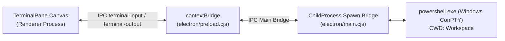

# Milestone 2: ConPTY Terminal & Code Editor Integration (M2)

Dokumen spesifikasi teknis dan implementasi untuk terminal interaktif native Windows dan code editor pada **DRACODECK** berbasis Electron.

---

## 1. Tujuan & Deliverables

1. **ConPTY Terminal Native Windows (Zero Compiler Overhead)**:
   - Terhubung langsung ke proses interaktif `powershell.exe` / `wsl.exe` melalui IPC streaming Node.js `child_process.spawn`.
   - Streaming stdout dan stderr real-time ke renderer via `terminal-output`.
   - Menerima input interaktif keyboard via `terminal-input` dengan command history (Up/Down arrow), SIGINT (`Ctrl+C`), dan clear screen (`Ctrl+L`).
   - Multi-tab management: `pwsh.exe:1`, `pwsh.exe:2`, dsb.
   - Tombol kontrol lifecycle: `CLEAR`, `RESTART`, `KILL`.

2. **VS Code-Style Code Editor & Interactive Minimap**:
   - Editor multi-tab dengan granular syntax highlighting (16+ token semantik).
   - Minimap interaktif di sisi kanan dengan micro code visualization dan slider viewport region.
   - Klik pada minimap memicu auto-scroll instan ke posisi file yang dituju.
   - Toggle button `[ MINIMAP ]` dan `[ SYNTAX ]` pada bar tab editor.
   - Hotkey `Ctrl+S` untuk penyimpanan instan ke filesystem lokal.

3. **Secure Local Filesystem Bridge (IPC API)**:
   - `readDir(dirPath)`: List direktori dengan filter aman.
   - `readFile(filePath)`: Membaca berkas UTF-8.
   - `writeFile(filePath, content)`: Menyimpan berkas.
   - `deleteFile(targetPath)`: Menghapus file/folder.
   - `renameFile(oldPath, newPath)`: Mengubah nama berkas.
   - `statFile(targetPath)`: Metadata berkas (size, mtime, isDirectory).

---

## 2. Arsitektur IPC Terminal & Process Lifecycle

