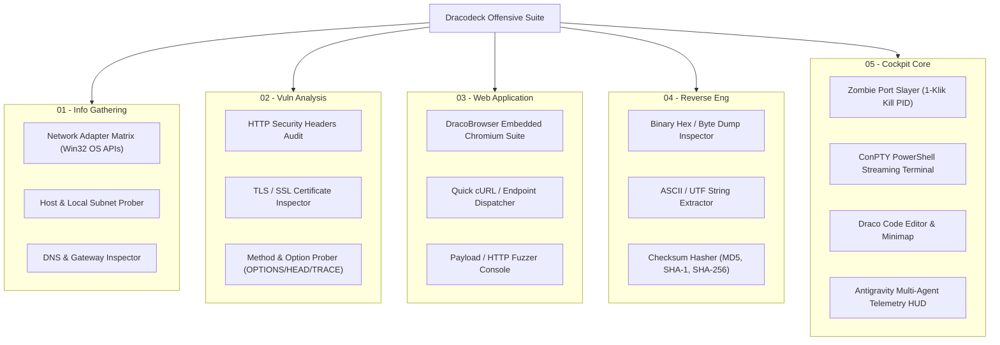

# Milestone 3.1: Terminal Engine Hardening, Dracodeck Offensive Suite & Cyberdeck Hacker Polish (M3.1)

> Status: **COMPLETED** (Commit: cc7e7fd -> main)

Dokumen arsitektur dan spesifikasi teknis untuk penyempurnaan terminal ConPTY, diferensiasi navigasi, sistem tooltip hacker kustom, pembersihan badge header, dan modul interaktif **Dracodeck Offensive Suite**.

---

## 1. Analisis Akar Masalah (Root Cause Analysis)

### 1.1 Masalah Terminal Dobel Eksekusi (Duplicate Execution)
Berdasarkan investigasi terhadap `src/components/terminal/TerminalPane.tsx`, `src/components/terminal/dracoShell.ts`, dan `electron/preload.cjs`:
1. **Listener Leak pada IPC Stream**:
   Pada `preload.cjs`, `window.dracoAPI.receive("terminal-output", callback)` memanggil `ipcRenderer.on(...)` tanpa mekanisme unregister (`removeListener`). Setiap kali `TerminalPane` di-mount (berganti tab, atau window desktop dibuka/tutup), listener baru terus ditambahkan tanpa menghapus listener lama. Akibatnya, satu output ConPTY memicu callback 2x, 3x, dst.
2. **Multi-Instance Collision**:
   `TerminalPane` dimuat di dua tempat sekaligus: di dalam `KaliDesktop.tsx` (window ConPTY melayang) dan di dalam `Shell.tsx` (view terminal). Keduanya mendengarkan channel IPC yang sama dan memancarkan ke stdin yang sama secara simultan.
3. **Pencampuran Perintah Windows & Linux di `dracoShell.ts`**:
   `dracoShell.ts` membajak perintah native `ipconfig`, `ifconfig`, dan `sudo apt update`. Intersepsi buatan ini bertabrakan dengan echo native PowerShell, menghasilkan duplikasi baris output palsu.

**Solusi M3.1**:
- Tambahkan API unregister listener (`off` / cleanup callback) di `preload.cjs` dan `TerminalPane.tsx`.
- Hapus pembajakan perintah shell native (`ifconfig`, `ipconfig`, `sudo apt`, dll.). Seluruh perintah standar Windows/PowerShell langsung dialirkan 100% ke native ConPTY process tanpa campur tangan.
- Command prefix `draco` diisolasi **khusus** untuk fitur internal Dracodeck.

---

### 1.2 Masalah Tampilan File Manager & Code Editor yang Identik
Pada `src/components/layout/Shell.tsx` baris 88-90:
```tsx
case "explorer":
case "editor":
  return <SplitPane left={<ExplorerView />} right={<EditorPane />} ... />;
```
Kedua menu memanggil struktur komponen yang sama persis (`SplitPane` dengan file explorer di kiri dan editor di kanan).

**Solusi M3.1**:
- **Draco File Manager (`explorer`)**: Tampilan penuh workstation manajemen berkas bergaya Dolphin/Thunar (Sidebar logical drives + directory breadcrumb + full visual grid/list explorer + file metadata inspector + bulk action toolbar).
- **Draco Code Editor (`editor`)**: Tampilan editor kode terfokus (fokus pada kanvas koding, minimap, multi-tab bar, breadcrumb baris, dengan collapsible micro-explorer).
- **Diferensiasi Taskbar**: Ikon, warna aksen, badge aktif, dan tooltip yang kontras berbeda (File Manager = Cyan `#00e5ff` Folder Matrix; Code Editor = Neon Magenta `#ff007f` Code Tags).

---

### 1.3 Pembersihan Badge "EXCLUSIVE F11 FULLSCREEN LIVE"
Pada `src/components/layout/TopBar.tsx` baris 48-52:
Elemen center tag `EXCLUSIVE F11 FULLSCREEN ● LIVE` dihapus sepenuhnya dari top bar agar ruang header bersih dan lapang.

---

### 1.4 Format Interaktif `draco` & Signature Operator
Ketika pengguna mengetik `draco` atau `draco help` di terminal:
- Tampilkan logo ASCII Art teks `DRACODECK`.
- Tampilkan kamus syntax modular resmi untuk ekosistem Dracodeck (Cockpit, NetSuite, PortSlayer, AI Hub).
- Footer signature wajib: `OPERATOR: elrazaq // AUTHORIZED OFFENSIVE COCKPIT`.

---

### 1.5 Spesifikasi Universal Custom Hacker Tooltip System
Gantikan semua atribut browser native `title="..."` yang kaku dan lambat dengan sistem tooltip kustom bergaya cyberdeck:
- **Design Tokens**:
  - Background: Obsidian void `#0e0a19`
  - Border: Cyberpunk neon cyan `#00e5ff`/40 atau hot magenta `#ff007f`/40
  - Typography: Monospace 10px uppercase, tracking-wider
  - Drop Shadow: Subtle neon ambient glow `shadow-[0_4px_20px_rgba(0,229,255,0.2)]`
  - Aksen Visual: Cyber corner notches / badge shortcut keyboard (misal: `[Ctrl+L]`, `[Enter]`, `[Alt+Tab]`)
- **Implementasi**: Komponen performa tinggi `<DracoTooltip>` atau directive atribut global `data-draco-tooltip` dengan waktu delay kemunculan instan (<120ms).
- **Cakupan**: Diaudit dan diterapkan di semua komponen UI (`TopBar`, `LeftDock`, `BottomBar`, `TerminalPane`, `EditorPane`, `ExplorerView`, `KaliDesktop`, `TelemetryPane`, `DiffViewer`, `DracoBrowser`).

---

## 2. Arsitektur Dracodeck Offensive Suite (5 Domain Modul)

Mengubah "Kali Offensive Suite" menjadi **Dracodeck Offensive Suite** dengan utilitas operasional riil:



### Detail Modul:
1. **01 - Info Gathering**:
   - Tampilan visual antarmuka kartu jaringan (IP v4/v6, subnet mask, MAC address, MTU, loopback) diambil langsung dari `os.networkInterfaces()`.
   - Tombol copy cepat untuk IP publik/lokal & gateway.
2. **02 - Vuln Analysis**:
   - Analisis header keamanan target URL (CSP, HSTS, X-Frame-Options, X-Content-Type-Options, Permissions-Policy).
   - Menampilkan status skor kerentanan konfigurasi header (Pass/Warning/Fail).
3. **03 - Web Application**:
   - Integrasi langsung dengan DracoBrowser bebas blokir CSP.
   - Quick HTTP Dispatcher: kirim method `GET`, `POST`, `HEAD`, `OPTIONS` dengan inspeksi payload respons dan status code latency.
4. **04 - Reverse Eng**:
   - **Binary Hex Inspector**: Membaca file biner lokal apa pun dan memetakan baris offset hex (00000000: 4D 5A 90 00 ...).
   - **String Extractor**: Mengekstrak string ASCII/UTF-8 berharga dari berkas executable/biner lokal.
   - **Checksum Generator**: Menghitung hash MD5, SHA-1, dan SHA-256 berkas lokal secara instan.
5. **05 - Cockpit Core**:
   - Shortcut langsung ke Port Slayer, ConPTY Terminal, Code Editor, dan AI Telemetry Hub.

---

## 3. Rencana Perubahan Berkas (Execution Blueprint)

| Berkas | Ruang Lingkup Perubahan |
| :--- | :--- |
| `electron/preload.cjs` | Tambahkan fungsi unregister `off(channel, func)` atau return cleanup listener pada IPC receive terminal |
| `src/components/terminal/TerminalPane.tsx` | Perbaiki lifecycle listener terminal (cleanup di `useEffect`), hapus echo ganda |
| `src/components/terminal/dracoShell.ts` | Hapus pembajakan perintah shell Windows; rancang ASCII art DRACODECK, command dictionary, dan signature `OPERATOR: elrazaq` |
| `src/components/layout/TopBar.tsx` | Hapus badge `EXCLUSIVE F11 FULLSCREEN ● LIVE` |
| `src/components/layout/LeftDock.tsx` | Ganti "Kali Offensive Suite" -> "Dracodeck Offensive Suite", integrasikan trigger modal/view untuk 5 domain modul |
| `src/components/layout/Shell.tsx` | Pisahkan view `explorer` (Dedicated Full File Manager) dan `editor` (Focused Code Editor) |
| `src/components/offensive/OffensiveSuiteModal.tsx` | Komponen baru antarmuka Dracodeck Offensive Suite 5 domain interaktif |
| `src/components/common/DracoTooltip.tsx` | Komponen tooltip kustom cyberdeck elegan anti-slop |
| `src/components/*` | Audit dan ganti semua atribut `title="..."` dengan `DracoTooltip` |

---

## 4. Kriteria Keberhasilan (Acceptance Criteria)

1. **Terminal Single Execution**: Mengetik perintah apa pun di terminal hanya menghasilkan 1 kali eksekusi dan 1 kali output. Perintah native PowerShell berjalan mulus tanpa diintersepsi.
2. **Perintah `draco` Murni**: Mengetik `draco` memunculkan teks logo ASCII Dracodeck, daftar syntax resmi yang rapi, dan signature `OPERATOR: elrazaq`.
3. **Badge F11 Hilang**: Tampilan TopBar bersih tanpa teks `EXCLUSIVE F11 FULLSCREEN LIVE`.
4. **Dracodeck Offensive Suite Aktif**: 5 domain (Info Gathering, Vuln Analysis, Web Application, Reverse Eng, Cockpit Core) memiliki antarmuka interaktif dan utilitas yang dapat dijalankan.
5. **Diferensiasi Explorer vs Editor**: Mengklik File Manager membuka Dolphin/FileManager view penuh, mengklik Code Editor membuka ruang koding terfokus.
6. **Hacker Tooltips di Seluruh Aplikasi**: Semua tombol dan ikon memiliki tooltip custom bernuansa cyberdeck/hacker gelap dengan border neon, monospace font, dan badge shortcut yang elegan.

