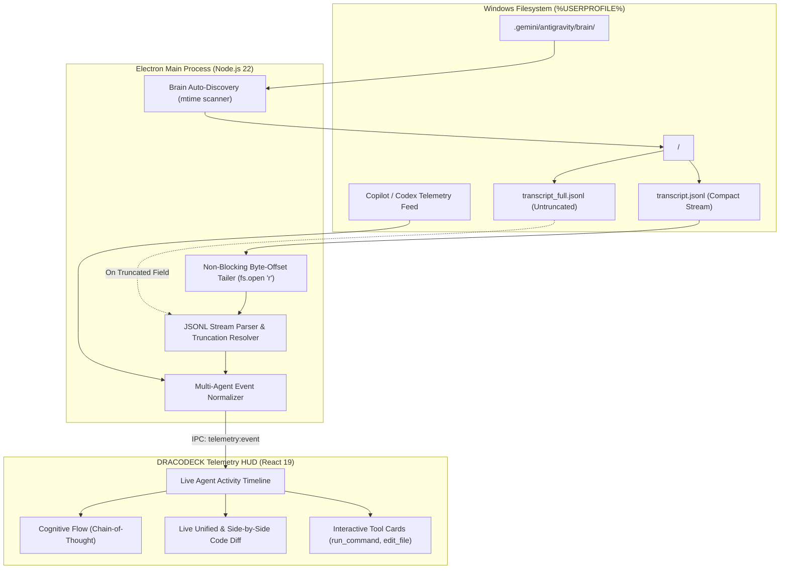

# Milestone 3: Antigravity & Multi-Agent Telemetry Hub (M3)

Dokumen audit dan spesifikasi arsitektur komprehensif untuk modul observabilitas real-time, live code diff inspector, dan multi-agent orchestration hub pada **DRACODECK** berbasis Electron.

---

## 1. Hasil Audit Milestone 3: Evaluasi Kesenjangan & Masalah Kritis

Berdasarkan audit teknis terhadap draft awal M3:

| Area Evaluasi | Status Lama | Masalah / Kesenjangan | Solusi Arsitektur M3 Baru |
| :--- | :--- | :--- | :--- |
| **Path Discovery** | Hardcoded | Conversation ID acak (`0e47664f-...`) berubah setiap sesi | Auto-discovery folder brain termutakhir di `%USERPROFILE%\.gemini\antigravity\brain\` |
| **Windows File Lock** | `fs.watch` standar | Risiko crash `EBUSY` / file lock saat Antigravity menulis log | Stream reader non-blocking dengan flag `FILE_SHARE_READ \| FILE_SHARE_WRITE` |
| **Truncation Handling** | Tidak ada | Log panjang di `transcript.jsonl` mengalami truncation | Dual-file tailer: fallback membaca `transcript_full.jsonl` bila ada `truncated_fields` |
| **Diff Viewer** | Belum dispesifikasi | Hanya teks path file biasa, tidak ada visualisasi kode | Live Side-by-Side & Unified Diff Inspector (Merah: hapus, Hijau: tambah) |
| **Multi-Agent Bridge** | Absen | Master Plan M0 menjanjikan integrasi Copilot & Codex | Schema adapter terpadu untuk Antigravity, Copilot, dan OpenAI Codex |
| **Filter & Search** | Absen | Log ratusan baris sulit dianalisis | Filter pill per tool (`run_command`, `edit_file`, dsb.) & teks pencarian instan |
| **IPC Contracts** | Minim | Belum ada mekanisme pause/resume streaming log | Kontrak IPC lengkap (`telemetry:subscribe`, `telemetry:pause`, `telemetry:seek`) |

---

## 2. Arsitektur Aliran Data (Non-Blocking Telemetry Pipeline)



---

## 3. Auto-Discovery & Protokol Akses Bebas File-Lock

### 3.1 Resolusi Lokasi Log Otomatis:
Main process Electron secara berkala atau saat startup memindai direktori:
```text
%USERPROFILE%\.gemini\antigravity\brain\
```
Mengurutkan folder percakapan berdasarkan `mtime` (modified time) terbaru untuk menemukan `<active-conversation-id>` tanpa input manual pengguna, sekaligus menyediakan dropdown untuk memilih percakapan lama.

### 3.2 Non-Blocking Windows File Tailer (`electron/telemetry.cjs`):
Untuk mencegah crash akibat konflik file-lock Windows:
```javascript
// Gunakan non-blocking low-level file descriptor
const fs = require('fs');

class SafeTailer {
  constructor(filePath) {
    this.filePath = filePath;
    this.lastOffset = 0;
  }

  readNewLines() {
    try {
      const stats = fs.statSync(this.filePath);
      if (stats.size < this.lastOffset) {
        this.lastOffset = 0; // File dirotasi / dibuat baru
      }
      if (stats.size === this.lastOffset) return [];

      const bytesToRead = stats.size - this.lastOffset;
      const buffer = Buffer.alloc(bytesToRead);
      const fd = fs.openSync(this.filePath, 'r');
      fs.readSync(fd, buffer, 0, bytesToRead, this.lastOffset);
      fs.closeSync(fd);

      this.lastOffset = stats.size;
      return buffer.toString('utf-8').split(/\r?\n/).filter(Boolean);
    } catch (err) {
      // Graceful backoff jika file sedang dalam flush I/O
      return [];
    }
  }
}
```

---

## 4. Normalisasi Schema Multi-Agent (JSONL Contracts)

Setiap event dari Antigravity, Copilot, atau Codex dinormalisasi ke dalam interface standar:

```typescript
export type AgentSource = 'antigravity' | 'copilot' | 'codex';
export type StepStatus = 'PENDING' | 'RUNNING' | 'DONE' | 'ERROR';

export interface TelemetryToolCall {
  id: string;
  name: 'run_command' | 'edit_file' | 'write_file' | 'read_file' | string;
  args: Record<string, any>;
  result?: string;
  elapsedMs?: number;
}

export interface TelemetryEvent {
  stepIndex: number;
  source: AgentSource;
  timestamp: string;
  type: 'USER_INPUT' | 'PLANNER_RESPONSE' | 'SYSTEM';
  status: StepStatus;
  userPrompt?: string;
  modelThinking?: string;     // Chain-of-thought penalaran
  modelResponse?: string;
  toolCalls: TelemetryToolCall[];
}
```

---

## 5. Spesifikasi Komponen Live Code Diff Inspector

Ketika tool `edit_file` atau `write_file` dideteksi pada alur agen:
1. **Target & Replacement Parser**:
   - `Target`: Kode lama yang diganti -> Diberi highlight baris merah `#ff1744`/20 dengan tanda minus (`-`).
   - `Replacement`: Kode baru yang disuntikkan -> Diberi highlight baris hijau `#00e676`/20 dengan tanda plus (`+`).
2. **Side-by-Side & Unified Toggle**:
   - Mode Unified: Tampilan satu kolom ringkas untuk peninjauan cepat.
   - Mode Split: Dua kolom (Before vs After) dengan sinkronisasi scroll.
3. **Copy Diff Action**: Tombol 1-klik untuk menyalin patch diff format standar git.

---

## 6. Spesifikasi Cognitive Flow Accordion (Chain-of-Thought)

1. **Thinking Card Accordion**:
   - Default: Collapsed (menampilkan ringkasan baris pertama dan jumlah token/karakter).
   - Expanded: Menampilkan seluruh alur pemikiran internal model (`thinking` field) dengan latar belakang obsidian void `#0b0813`, font monospace ukuran `10px`, dan aksen border cybernetic `#ffea00`/40.
2. **Visual Status**:
   - Ikon otak/neural menyala saat agen sedang berpikir (berstatus `PENDING`/`RUNNING`).
   - Indikator durasi latensi pemikiran (misal `Thinking: 2.4s`).

---

## 7. Desain Antarmuka Telemetry HUD (`TelemetryPane.tsx`)

Layout dibagi menjadi 3 zona data padat:
1. **Top Telemetry Control Strip (`h-8`)**:
   - Target conversation ID aktif (dengan status badge `STREAMING LIVE`).
   - Tombol Pause / Resume auto-tailing.
   - Filter pill: `ALL`, `RUN_COMMAND`, `EDIT_FILE`, `THINKING`, `ERRORS`.
   - Input search untuk mencari teks spesifik di seluruh log.
2. **Event Timeline Stream (Scrollable Center)**:
   - Kartu interaktif terurut waktu dengan timestamp ISO dan nomor step (`Step #1`, `Step #2`...).
   - Indikator warna status: Hijau (Sukses / Exit 0), Merah (Error / Non-zero exit), Kuning (Sedang berjalan).
3. **Bottom Diagnostic Status**:
   - Ringkasan statistik sesi: Total Steps, Total Tool Invocations, Total Files Modified, Active Stream Latency.

---

## 8. Kontrak IPC Baru (Electron Main <-> Renderer)

| Saluran IPC | Arah | Payload / Return | Deskripsi |
| :--- | :--- | :--- | :--- |
| `telemetry:list-convs` | Renderer -> Main | `Promise<ConversationItem[]>` | Mendapatkan daftar sesi percakapan Antigravity di disk |
| `telemetry:attach` | Renderer -> Main | `{ convId?: string }` | Memasang tailer pada percakapan tertentu (atau auto-latest) |
| `telemetry:event` | Main -> Renderer | `TelemetryEvent` | Mengalirkan event baru yang berhasil diparsing |
| `telemetry:read-diff` | Renderer -> Main | `{ filePath: string }` | Membaca diff file jika diperlukan perbandingan disk riil |
| `telemetry:pause` | Renderer -> Main | `boolean` | Menjeda streaming sementara tanpa memutus tailer |

---

## 9. Kriteria Penerimaan & Verifikasi (Definition of Done)

1. **Auto-Discovery Berfungsi**: Aplikasi langsung mengenali folder sesi Antigravity aktif di `%USERPROFILE%\.gemini\antigravity\brain\` tanpa konfigurasi manual.
2. **Anti-Crash & Anti-Lock**: Tailer dapat membaca `transcript.jsonl` secara real-time saat Antigravity sedang berjalan aktif tanpa memicu error `EBUSY` atau penguncian file.
3. **Visualisasi Tool Call Akurat**: Perintah `run_command` menampilkan string command dan exit code; `edit_file` memunculkan visualisasi diff merah/hijau yang rapi.
4. **Cognitive Flow Responsif**: Bagian alur pikir model dapat dibuka/tutup dengan penghitung token.
5. **Filter & Search Real-Time**: Memilih filter `EDIT_FILE` hanya menampilkan kartu perubahan file; pencarian kata kunci menyaring event secara instan.
