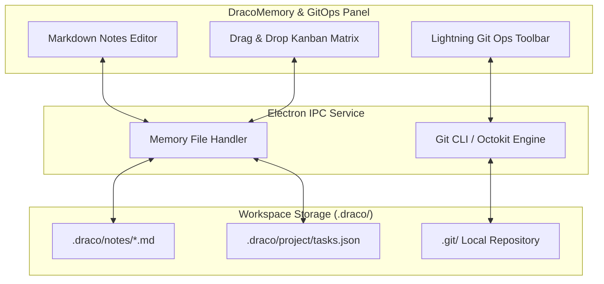

# Milestone 5: DracoMemory & 1-Click Git Ops (M5)

Dokumen spesifikasi teknis untuk modul memori internal, project management, dan operasional kilat GitHub pada **DRACODECK**.

---

## 1. Tujuan & Deliverables

1. **DracoMemory (Internal Notes & Scratchpads)**:
   - Editor catatan internal berbasis Markdown di dalam cockpit.
   - Tersimpan rapi di `<WORKSPACE>/.draco/notes/*.md`.
2. **Project Management & Scheduling (GitHub-Style)**:
   - Kanban Board: Kolom `Backlog`, `In Progress`, `Review`, `Done`.
   - Milestone & Issue Tracker: Estimasi deadline, prioritas label, dan task checklist.
   - Penyimpanan lokal dalam format JSON/Markdown di `<WORKSPACE>/.draco/project/tasks.json`.
3. **1-Click Lightning GitHub Ops**:
   - Fast Branch Switcher: dropdown daftar branch lokal dan remote, 1-klik buat branch baru atau checkout.
   - Quick Commit & Sync: Input pesan commit cepat, tombol `[ STAGE & COMMIT ]` dan `[ PUSH / SYNC ]` dalam 1 klik.
4. **Multi-Agent Orchestration Adapter**:
   - Dukungan koneksi multi-agent (Google Antigravity, GitHub Copilot, OpenAI Codex).

---

## 2. Arsitektur Data & Penyimpanan (`.draco/`)

---

## 3. Spesifikasi Fitur Git Ops Kilat

- **Switch Branch**: Menjalankan `git checkout <branch>` atau `git switch <branch>` instan di background via Node.js `child_process`.
- **Create Branch**: Dialog popover 1 baris: ketik nama branch baru -> otomatis `git checkout -b <name>`.
- **Commit & Push**:
  - Tombol `[ COMMIT & PUSH ]`: otomatis menjalankan `git add .`, `git commit -m "<message>"`, dan `git push origin <branch>` dalam satu klik tanpa membuka terminal.

---

## 4. Verification & Acceptance Criteria

1. Catatan baru dapat dibuat, diedit, dan tersimpan otomatis ke folder `.draco/notes/`.
2. Task Kanban dapat dipindahkan antar status dan bertahan saat aplikasi ditutup lalu dibuka kembali.
3. Pergantian branch git terjadi dalam waktu < 500ms dan langsung me-refresh file tree explorer.

